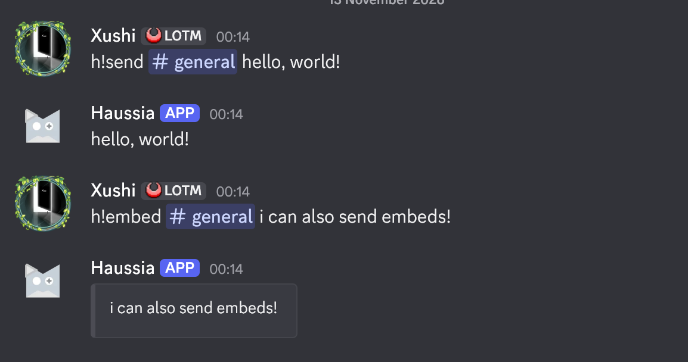

<div align="center">
    
</div>

# Haussia

A simple bot for managing messages in Discord, built out of necessity and passion.

## Description

Haussia is a relatively simple bot to manage messages in Discord, the use case is for servers who has a large team of moderators to be able to manage a single message or rules without having to wait for the person who sent the message to be awake.
The bot is built on top of [Discord.js](https://discord.js.org) using JavaScript, it uses Keyv + SQLite to store data locally.

### Screenshots



## Getting Started

### Dependencies

* nodejs v24.21.0 or higher
* npm 11.19.0 or higher
* a working discord account
* git version 2.56.0 or higher (to clone the repository)

### Installing

* You will need to install the dependencies (as listed above) from [NodeJS download page](https://nodejs.org/en/download)
* Note that there is no specific installation path for running the bot, you can put it almost anywhere
* `cd` into the directory where you want to store the repository and run `git clone https://github.com/xushidev/haussia.git` (or the codeberg upstream if you want)
* You will need to get "Application ID" (or Client ID) from [Discord's Developer Portal](https://discord.com/developers/home)
* You will also need to get the "Client Secret" from the Developer Portal (both of which you can find in your discord application's OAuth2 Page)
* You should give the bot the appropriate permissions during installation (Overview > Installation) where under the guild install it needs `application.commands` and `bot` scope with the following minimum required permissions: `embed links`, `view channels`, `view audit log`, `send messages`; any other permissions the bot may have is up to you.
* You will also need to enable the `Server Members Intent` and `Message Content Intent` under the "bot" pannel under the "priviledged intent" section.
* To install `nodejs` dependencies you will have to be inside the repository's directory and run `npm install`
* Upload the commands using `npm run deploy::prod` to the discord bot
* Enable the databases by creating two empty files named `prefix.sqlite` and `roles.sqlite` under the `src/data/` folder from the root of the repository

### Configuration

* Rename the `config.example.json` into `config.json`
* Use your editor of choice to modify the parameters inside:
    * Paste your "Client Secret" as "Token" value
    * Paste your "Client ID" as "clientId" value
    * (only if you want to test it out in a test server) copy your server's ID (by right clicking your test discord server icon and selecting "Copy Server ID") and paste it instead of "guildId"
    * Insert a global prefix you want as the value of "globalPrefix"

### Executing program

* `cd` into the repository's directory
* run `npm run start` to start the bot
* test out in your discord server of choice (where you added your bot) using the `/ping` command or simply sending a message with `<your-global-prefix>ping`

## Help

Most of the issues caused by crashes of the bot can be simply fixed by restarting the bot (in it's repository):
```sh
npm run start
```

Should there be a need to eliminate the databases, you can simply remove the databases from the `src/data/` folder and recreate them as empty files (with the same name as before).

If Haussia seems not to be working well with embedded images (as in, she isn't turning links into images), check if you have given it the `embed links` permission during the installation settings.

## License

This project is licensed under the [GNU GPLv3](LICENSE.txt) License - see the LICENSE.txt file for details
